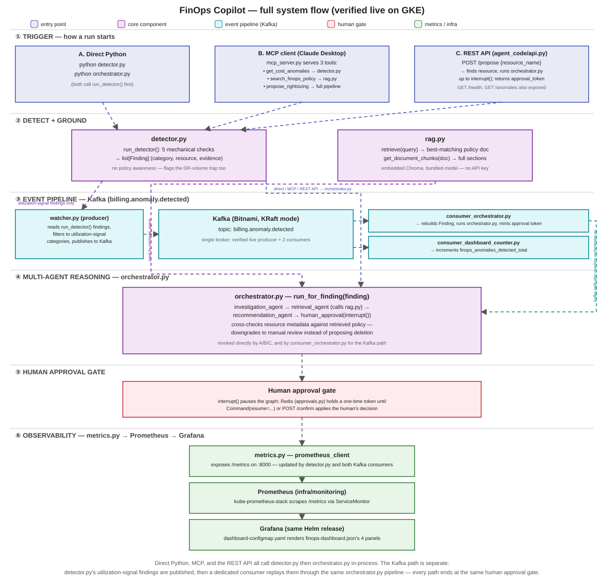
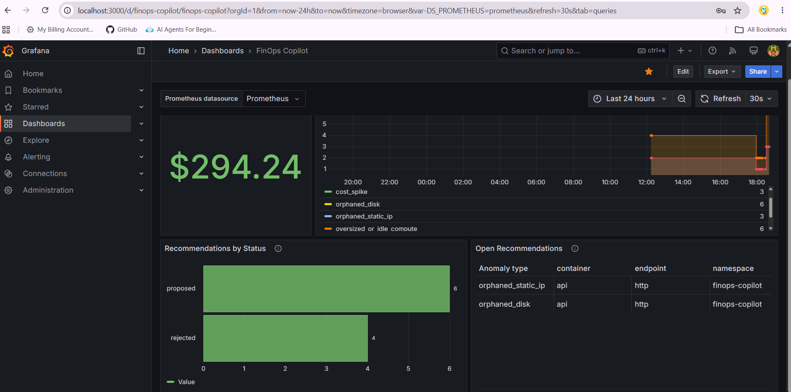
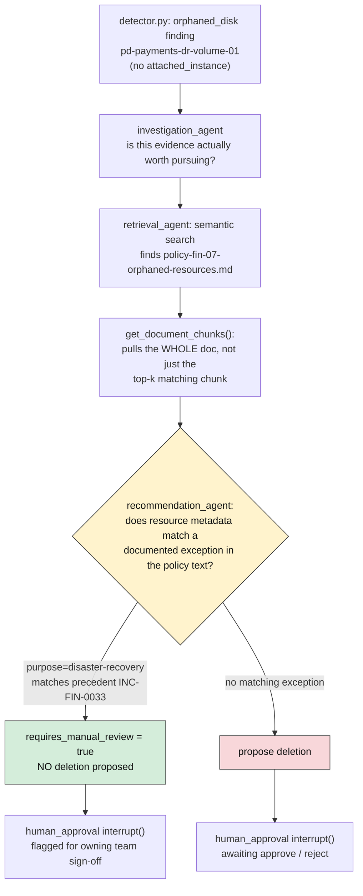

# FinOps Copilot

An agent that catches wasted cloud spend, checks it against real company policy before suggesting anything, and never touches a resource without a human saying yes first.

## Why I built this

Cost anomaly detection by itself is easy: flag anything idle, flag anything unattached, done. The hard part is that "looks wasteful" and "is actually wasteful" aren't the same thing. A disk with nothing attached to it might be garbage, or it might be a disaster-recovery backup someone deliberately provisioned that way. A dumb detector can't tell the difference, and a naive AI agent that just eyeballs the numbers will confidently make the same mistake.

So this project is built around that specific failure mode. A cheap, deterministic rule-based layer finds anomalies. A separate reasoning layer checks each one against real policy documents before deciding what to recommend, and it has to cite the exact policy section it's relying on. Nothing gets deleted, resized, or touched without a human approving it, and that approval has to survive a crash or getting picked up by a completely different process. It runs on a real GKE cluster, with a real event pipeline behind it, not just on my laptop.

## What it does

`detector.py` reads billing, utilization, and inventory data and flags anomalies across five categories — idle compute, orphaned disks, orphaned static IPs, cost spikes, stale storage. It has zero policy awareness by design. Left alone it'll happily flag a disaster-recovery volume for deletion, which is the whole point — something downstream has to catch that.

That something is `orchestrator.py`, a four-step LangGraph pipeline. One step decides whether a finding is actually worth pursuing. Another searches Chroma and pulls the *whole* matching policy document, not just the closest chunk, so a short "precedent" section can't get lost. A third checks the resource's metadata against that policy text — if it matches a documented exception, the recommendation downgrades to "flag for manual review" instead of proposing something destructive. The last step just stops and waits. Nothing is final until a person resumes it, and that resume can come from a completely different process than the one that paused, because the state and the one-time approval token both live in Redis.

There are four ways to kick off a run and they all land in the same pipeline: running `detector.py` / `orchestrator.py` directly, calling the REST API, asking an MCP client (Claude Desktop, Claude Code) to use `propose_rightsizing`, or letting a Kafka event trigger it when a resource's utilization breaches a threshold.

Every finding and every recommendation also emits a Prometheus metric, which is what shows up on the Grafana dashboard.

## Architecture



`detector.py` feeds `orchestrator.py`. Two things can call into that pipeline from the outside — `api.py` (REST) and `mcp_server.py` (MCP over stdio) — and a third path comes in sideways through `events/`, where a Kafka consumer reconstructs a finding from an event and runs the same pipeline. `metrics.py` is wired into all of it and feeds Grafana. Everything under `infra/` is what actually runs this on Kubernetes: Kafka, Redis, monitoring, and the API service.

Every piece above has been run for real against a live GKE cluster, not just locally — including CI/CD itself (a real code change triggered `build-and-push.yml`, which opened a PR, and merging it triggered `sync-manifest-to-cluster.yml`, which deployed the new image).

## Stack

Python, LangGraph for the agent graph, OpenAI for the LLM (swappable — see `orchestrator.py`'s `_make_llm()`), Chroma for retrieval (embedded in-process, no separate service to run), Kafka for events (Bitnami's Helm chart, KRaft mode), Redis for state and approval tokens (`redis-stack-server`, needed for RediSearch), Prometheus + Grafana for metrics, MCP's low-level `Server` API for tool access, pytest for testing, Helm charts and raw manifests for infra.

## Project layout

```
finops-copilot/
├── agent_code/                  # Docker build context
│   ├── generate_mock_data.py    # Generates data/billing/*
│   ├── detector.py              # Rule-based anomaly detector
│   ├── rag.py                   # Chroma ingestion + retrieve()
│   ├── orchestrator.py          # LangGraph multi-agent graph
│   ├── api.py                   # FastAPI wrapper
│   ├── mcp_server.py            # MCP tool server (stdio)
│   ├── metrics.py               # Prometheus metric definitions
│   ├── approvals.py             # Shared Redis approval-token store
│   ├── data/
│   │   ├── billing/             # Generated mock billing/utilization/metadata
│   │   └── policies/            # 4 FinOps policy docs (RAG source)
│   ├── events/                  # Kafka producer + 2 consumers
│   ├── evals/                   # Scenario-based eval harness
│   ├── test_*.py                # pytest suite
│   ├── requirements.txt
│   └── Dockerfile
├── infra/
│   ├── kafka/                   # Bitnami Kafka: Helm values + setup/verify scripts
│   ├── monitoring/               # kube-prometheus-stack + dashboard + ServiceMonitor
│   ├── redis/                    # Redis Deployment/Service
│   ├── api/                     # API Deployment/Service
│   └── terraform/                # reference copy — applied from a separate, shared repo
├── grafana/                     # dashboard JSON + local import instructions
├── Assets/                      # architecture diagrams
└── .github/workflows/            # build-and-push, sync-manifest-to-cluster, pr-validation
```

## Setup

Needs Python 3.11+, and an OpenAI key if you want `orchestrator.py` or `mcp_server.py` — `detector.py` and `rag.py` alone don't need one.

```bash
cd agent_code
pip install -r requirements.txt
echo 'OPENAI_API_KEY="sk-..."' > .env
python generate_mock_data.py
python rag.py             # ingests policy docs into Chroma
python -m pytest -q       # confirm everything works
```

## Using it

All commands below run from `agent_code/`.

Just the detector, no LLM or API key needed:
```bash
python detector.py
```

Just policy search, also no LLM:
```bash
python -c "import rag; [print(r['source_file'], '::', r['section_title']) for r in rag.retrieve('orphaned disk that is actually for disaster recovery', top_k=3)]"
```

The full orchestrator (needs `OPENAI_API_KEY`):
```bash
python orchestrator.py
```
This runs the DR-volume trap case end to end and pauses at `interrupt()`. To resume it yourself:
```python
from langgraph.types import Command
import detector, orchestrator

finding = next(f for f in detector.run_detector() if f.resource_name == "pd-payments-dr-volume-01")
app, result, config = orchestrator.run_for_finding(finding, thread_id="my-review")
print(result["recommendation"])
final_state = app.invoke(Command(resume={"approved": True, "approver": "you"}), config=config)
```

For the REST API, see `infra/api/README.md` for the deployed version, or run `api.py` locally with `REDIS_URL` set.

For the MCP server:
```bash
python mcp_server.py
```
It talks over stdio, so it needs to be launched by an MCP client, not run standalone. Claude Desktop / Claude Code config:
```json
{
  "mcpServers": {
    "finops-copilot": {
      "command": "python",
      "args": ["mcp_server.py"],
      "cwd": "/path/to/finops-copilot/agent_code",
      "env": { "OPENAI_API_KEY": "sk-..." }
    }
  }
}
```
Three tools are exposed: `get_cost_anomalies` (calls `detector.run_detector()`), `search_finops_policy` (calls `rag.retrieve()`), and `propose_rightsizing` (calls `orchestrator.run_for_finding()`, up to `interrupt()`). Only the last one touches an LLM.

For metrics and the dashboard:
```bash
python -c "import metrics; metrics.start_metrics_server(port=8000)"
```
From there, follow `grafana/README.md` for a local Prometheus + Grafana setup, or `infra/monitoring/README.md` for the real deployment. This is what it looks like running against the real cluster:



## Testing

```bash
python -m pytest -q                            # everything
python -m pytest -q -s test_orchestrator.py     # see the actual LLM output
```

`test_orchestrator.py`, `test_metrics.py`, and `test_mcp_server.py` make real OpenAI calls on purpose — mocking the LLM would just be testing that a mock returns what you told it to return. `test_events.py`, `test_watcher.py`, and `test_consumers.py` mock the `confluent_kafka` client instead, since there's no live broker in CI.

## The DR-volume trap

`generate_mock_data.py` produces three files for 9 resources: a billing export, daily utilization, and inventory metadata (attachment status, last-access date). They're kept separate on purpose — cost alone can't tell you a resource is idle.

One of those resources, `pd-payments-dr-volume-01`, is the trap this whole project exists to catch. A naive detector flags it for deletion because nothing's attached to it. But it's tagged `purpose=disaster-recovery`, and that matches a documented precedent in the policy docs. Whether the recommendation step actually catches this — instead of just restating the detector's mistake with more confidence — is the thing I built this project to prove.



The `get_document_chunks()` step exists because of a real bug I hit while building this. The first version of `retrieval_agent` only pulled the top-k *chunks* from Chroma, and for this exact case the short "Precedent" section — where `INC-FIN-0033` lives — ranked below the cutoff. The agent never saw it, and confidently proposed deleting a disaster-recovery volume. The fix was two-stage retrieval: semantic search picks the right *document*, then the whole document gets pulled directly by filename, skipping a second similarity search entirely. `test_orchestrator.py` asserts this exact case by name so it can't quietly regress.

## About the billing data

Everything above runs against mock data today — this is a portfolio project, not something plugged into a real GCP bill. But there's also a working BigQuery backend, not because the project needs two data sources, but because if this ever does get pointed at a real cloud bill, I wanted that path already built and tested rather than something to figure out under pressure later. Set `BIGQUERY_DATASET` (`project.dataset`) and `detector.py` reads from three BigQuery tables instead of the local CSV/JSON files; leave it unset and it behaves exactly as before. It's exercised the same way the CSV path is — same detector code, same 7 findings, same DR-volume trap case, just a different source underneath.

To create the dataset and tables once:

```bash
bq mk --dataset --location=REGION PROJECT_ID:finops_copilot

bq mk --table PROJECT_ID:finops_copilot.billing_export \
  date:DATE,project_id:STRING,team:STRING,service:STRING,sku_description:STRING,resource_name:STRING,region:STRING,cost_usd:FLOAT64

bq mk --table PROJECT_ID:finops_copilot.utilization_metrics \
  date:DATE,resource_name:STRING,avg_cpu_pct:FLOAT64,avg_mem_pct:FLOAT64

bq mk --table PROJECT_ID:finops_copilot.resource_metadata \
  resource_name:STRING,team:STRING,attached_instance:BOOLEAN,last_accessed_days_ago:INTEGER,extra_attributes:STRING
```

`extra_attributes` is a JSON string holding whatever fields don't fit a fixed schema — `machine_type`, `disk_type`, `purpose`, since these vary by resource type. The service account needs `roles/bigquery.dataEditor` on the dataset and `roles/bigquery.jobUser` at the project level.

## A few design decisions

Things that might look arbitrary without the reasoning behind them:

- Chroma runs embedded in-process. No separate vector DB service to stand up.
- Retrieval is two-stage, as above — `retrieve()` finds the right document, `get_document_chunks()` grabs the whole thing by filename without a second similarity search, because vector matching was the reason the Precedent section got missed in the first place.
- The Kafka trigger is a utilization breach, not a billing event. Billing export is daily-batch and far too slow to react to anything in real time.
- The checkpointer in `orchestrator.py` is `InMemorySaver` by default and switches to a Redis-backed `RedisSaver` when `REDIS_URL` is set — that's the whole reason `api.py` can resume a paused run from a completely different request or pod.
- Metrics use `status ∈ {proposed, approved, rejected}`. There's no separate "manual review" status — a downgrade to manual review still counts as `rejected`, because the pipeline is refusing to let it through on its own either way.

## Where it stands

Everything described above is built and has been run for real against a live GKE cluster — not just locally, not just claimed. Redis, the API, BigQuery (through Workload Identity), Kafka (including a real event actually triggering the real orchestrator pipeline), the MCP server, monitoring, and CI/CD have all been exercised end to end, with the real bugs that came up along the way and how they got fixed written up in each `infra/*/README.md`.
